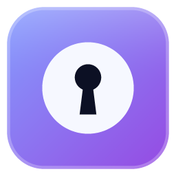

<div align="center">



# KeepSave

**A personal, KeePass-compatible password manager written in native Rust,
with a minimalist dark "liquid glass" UI and Google Drive sync.**

[](https://github.com/Juanestban/keepsave/actions/workflows/ci.yml)
[](#license)


</div>

> [!WARNING]
> KeepSave is in **early development**. Local vaults work end to end (groups,
> entries, search, autosave, auto-lock, settings). Google Drive sync is
> written but still awaiting a check with a real account, and the code hasn't
> been audited. Keep a backup of any vault you use with it.
> See [ROADMAP.md](ROADMAP.md) for the current status.

## Why KeepSave?

KeePass is great, but it looks dated, and keeping a vault in sync across
computers takes manual work. KeepSave keeps what makes KeePass trustworthy and
adds:

- **Standard KDBX4 files.** Your vault is a normal KeePass database, so you
  can always open it in KeePassXC or KeePass. No lock-in.
- **A modern interface.** Minimalist, dark, translucent glass panels over a
  soft animated background, with fast and fluid animations.
- **Google Drive sync built in.** Connect your Drive once and your vaults sync
  both ways, with a KeePass-style merge and versioned backups. On a new PC you
  sign in and import your vaults.
- **Local-first and private.** The vault is encrypted on your machine before
  anything is uploaded. Google only ever stores the encrypted file.

## Features

| Feature | Status |
| --- | --- |
| Create / open / save KDBX4 vaults (Argon2id, atomic writes) | ✅ Done (core) |
| Groups, entries, custom fields (protected or plain) | ✅ Done (core) |
| Entry history (last 10 versions) with restore | ✅ Done (core) |
| Recycle bin with permanent delete | ✅ Done (core) |
| Argon2id calibrated to ~1 s unlock with 64 MiB | ✅ Done (core) |
| Password generator: characters or EFF passphrase, with entropy | ✅ Done (core) |
| Search across title, username, URL, notes and tags | ✅ Done (core) |
| Liquid glass UI, Inter font, Phosphor icons | ✅ Done |
| Spanish and English, with system language detection | ✅ Done |
| Welcome, create vault and unlock screens | ✅ Done |
| Main screen: groups, entry list, detail panel, inline generator | ✅ Done |
| Clipboard auto-clear (15 s), KeePass shortcuts, autosave | ✅ Done |
| Auto-lock (inactivity, minimize, OS sleep / session lock) | ✅ Done |
| Google Drive connection, upload and import on a new PC | 🟨 M4 (awaiting a real-account check) |
| Bidirectional sync, merge and versioned backups | 🟨 M5 (awaiting a real-account check) |
| Settings, standalone generator, About | ✅ Done |
| Portable release `.exe` | 🟨 M6 (awaiting a KeePassXC check) |
| MSI installer (per user, no admin rights) | ✅ Done |
| Update checks with an in-app banner, download and restart | ✅ Done |
| Windows Hello quick unlock after a lock (per vault, until exit) | 🟨 M9 (awaiting a manual check) |

Planned next: auto-type, attachments, key files, entry templates, CSV import
and code signing.

## Installation

Each [release](https://github.com/Juanestban/keepsave/releases) has two
Windows downloads, with everything embedded:

- **`keepsave-<version>-x64.msi`**: installs for your user only, in
  `%LOCALAPPDATA%\Programs\KeepSave`, with a Start menu shortcut. No
  administrator rights needed. Uninstall it from *Settings → Apps*.
- **`keepsave-<version>-x64-portable.exe`**: a single file. Copy it anywhere
  and run it.

Both check for new versions and offer to update themselves (see
[Updates](#updates)). They aren't code-signed yet, so Windows SmartScreen
warns the first time you run them. `SHA256SUMS.txt` lists their checksums.

You can also build KeepSave from source as below.

### Requirements (all platforms)

- [Rust](https://rustup.rs/), latest stable (edition 2024 needs 1.85 or newer)
- Git
- A GPU driver that supports DirectX 12, Vulkan or Metal (used by `wgpu`)

### Windows (primary platform)

1. Install the **Visual Studio Build Tools** with the *Desktop development
   with C++* workload. Rust needs them for linking on Windows, and the
   Windows SDK they include provides `rc.exe`, which embeds the app icon.
2. Install Rust from <https://rustup.rs/> (pick the default
   `x86_64-pc-windows-msvc` toolchain).
3. Clone and build:

   ```powershell
   git clone https://github.com/Juanestban/keepsave.git
   cd keepsave
   cargo build --release -p keepsave-app
   ```

4. The portable executable is at `target\release\keepsave.exe`. Copy it
   anywhere and run it. No installer is needed.

### macOS (not officially supported yet)

KeepSave targets Windows first. It is written in cross-platform Rust, so
building on macOS should work, but it isn't tested yet.

```sh
xcode-select --install                       # compiler and linker
curl --proto '=https' --tlsv1.2 -sSf https://sh.rustup.rs | sh
git clone https://github.com/Juanestban/keepsave.git
cd keepsave
cargo build --release -p keepsave-app
./target/release/keepsave
```

### Linux (not officially supported yet)

Like macOS, this should work but isn't tested yet. The GUI and the system
keyring need a few development packages. On Debian/Ubuntu:

```sh
sudo apt install build-essential pkg-config libxkbcommon-dev \
  libxcb-render0-dev libxcb-shape0-dev libxcb-xfixes0-dev \
  libgtk-3-dev libdbus-1-dev libssl-dev
curl --proto '=https' --tlsv1.2 -sSf https://sh.rustup.rs | sh
git clone https://github.com/Juanestban/keepsave.git
cd keepsave
cargo build --release -p keepsave-app
./target/release/keepsave
```

On Fedora, install the matching packages: `gcc pkg-config libxkbcommon-devel
libxcb-devel gtk3-devel dbus-devel openssl-devel`.

### Google Drive credentials

Drive sync uses your own Google OAuth client. You don't need it to build:
KeepSave opens a step-by-step guide the first time you choose *Set up Google
Drive*, and stores the client you paste in the OS credential store. The same
steps are in [docs/GOOGLE_SETUP.md](docs/GOOGLE_SETUP.md).

No build embeds a client, so nothing secret ends up in a published `.exe`.

## Security model

- **Encryption:** KDBX4 with Argon2id. KeepSave calibrates the key derivation
  so that unlocking takes about one second on your machine, using 64 MiB of
  memory.
- **Secrets in memory:** passwords are held in `secrecy`/`zeroize` types and
  wiped when dropped. They are never logged and never printed for debugging.
- **Clipboard:** copied secrets are cleared after 15 seconds (configurable
  in Settings), and on lock or exit, but only if the clipboard still holds them. On Windows they are kept
  out of the clipboard history and the cloud clipboard.
- **Auto-lock:** after 5 minutes of inactivity, when the window is minimized,
  and when the OS goes to sleep or the session is locked; each can be changed
  in Settings → Security. Pending changes are saved first.
- **Links:** only `http` and `https` URLs are opened from an entry.
- **Sync:** before KeepSave overwrites the copy on Drive it keeps the old one
  in `KeepSave/backups/` (last 10 per vault). A Drive copy with a different
  master password is never overwritten.
- **Google Drive:** you connect through your own Google OAuth client, so no
  shared app stands between you and your Drive. OAuth uses a loopback
  redirect with PKCE and only the `drive.file` scope, so KeepSave can only
  see the files it created itself. The client is kept in the OS credential
  store.
  The refresh token is stored in the OS keyring (Windows Credential Manager),
  not in a config file.
- **Updates:** downloads are checked against the release's SHA-256
  checksums before they are installed. Without code signing this catches
  damaged downloads, not a compromised GitHub account.
- **Generator:** uses the OS random number generator. Passphrases use the
  [EFF large wordlist](https://www.eff.org/dice).

Your master password can't be recovered. If you forget it, the vault is
gone. Keep a backup of it somewhere safe.

## Updates

KeepSave asks GitHub for the latest release when it starts and every 6 hours
while it runs. When there is a newer version, a card at the bottom right
offers to update. KeepSave downloads it, checks it against the release's
`SHA256SUMS.txt`, and restarts into it. An open vault is saved and locked
first. The MSI version updates through Windows Installer, and the portable
`.exe` replaces itself.

The check sends nothing but a normal HTTPS request with the `KeepSave/<version>`
user agent. You can turn it off in *Settings → About*, where *Check now* is
always available.

## Keyboard shortcuts

KeepSave follows KeePass:

| Shortcut | Action |
| --- | --- |
| `Ctrl+B` / `Ctrl+C` | Copy the username / password of the selected entry |
| `Ctrl+U` | Open the entry's URL |
| `Ctrl+N` | New entry |
| `Ctrl+F` | Search |
| `Ctrl+S` | Save now (changes are also saved automatically) |
| `Ctrl+L` | Lock |
| `↑` `↓` / `Enter` / `Delete` | Move through entries / edit / move to the recycle bin |
| `Esc` | Cancel editing, clear the search, or close the detail panel |

## Where KeepSave stores data

| What | Where (Windows) |
| --- | --- |
| Vaults | Wherever you choose (`.kdbx` files) |
| Settings | `%APPDATA%\KeepSave\config.toml` (edited from the Settings screen) |
| Google refresh token | Windows Credential Manager |
| Drive copies | A visible `KeepSave/` folder in your Drive, backups in `KeepSave/backups/` (last 10) |

## Project layout

```
crates/keepsave-core   # vault model, KDBX I/O, merge, generator (no UI, no network)
crates/keepsave-sync   # Google OAuth and the Drive REST client
crates/keepsave-app    # eframe desktop app: theme, animations, i18n, screens
docs/                  # design decisions and the Google setup guide
scripts/make_icon.py   # draws the app icon (Python standard library only)
scripts/package.ps1    # builds the MSI, the portable .exe and SHA256SUMS.txt
```

The architecture and the reasoning behind every decision are in
[docs/DESIGN.md](docs/DESIGN.md).

## Development

```sh
cargo run -p keepsave-app                               # run the app
cargo test --workspace                                  # run the tests
cargo test -p keepsave-core --release -- --ignored      # slow Argon2 calibration test
cargo fmt --all -- --check                              # check formatting
cargo clippy --workspace --all-targets -- -D warnings   # lint
```

CI runs formatting, clippy and the tests on Windows for every push to `main`
and every pull request.

### Releasing

1. Set the version in the root `Cargo.toml` (`[workspace.package]`).
2. Commit, then tag and push: `git tag v1.2.0 && git push origin v1.2.0`.
   A suffix such as `v1.2.0-rc.1` publishes a pre-release, which the
   in-app updater ignores.
3. The [release workflow](.github/workflows/release.yml) checks the tag
   matches the version, runs the checks, builds (without a Google client:
   users set up their own), and publishes the release with the MSI, the
   portable `.exe` and `SHA256SUMS.txt`.

To package locally, install [WiX](https://wixtoolset.org/) v5
(`dotnet tool install --global wix --version 5.0.2`), then run:

```powershell
cargo build --release -p keepsave-app
./scripts/package.ps1   # writes target\dist
```

Code, comments, commit messages and docs are in English. Commits follow
[Conventional Commits](https://www.conventionalcommits.org/) (`feat(core): …`,
`fix(app): …`, `docs: …`).

## Acknowledgements

- [KeePass](https://keepass.info/) and [KeePassXC](https://keepassxc.org/),
  for the format and the behavior KeepSave follows.
- The [`keepass`](https://crates.io/crates/keepass) crate, for KDBX4 support.
- [egui / eframe](https://github.com/emilk/egui), for the UI framework.
- [Inter](https://rsms.me/inter/) by Rasmus Andersson, licensed under the
  [SIL Open Font License 1.1](crates/keepsave-app/assets/fonts/OFL.txt).
- [Phosphor Icons](https://phosphoricons.com/), through
  [`egui-phosphor`](https://crates.io/crates/egui-phosphor).
- The [EFF large wordlist](https://www.eff.org/dice) by the Electronic
  Frontier Foundation, licensed under
  [CC BY 3.0](https://creativecommons.org/licenses/by/3.0/us/).

## License

Licensed under either of

- Apache License, Version 2.0 ([LICENSE-APACHE](LICENSE-APACHE))
- MIT license ([LICENSE-MIT](LICENSE-MIT))

at your option.

Unless you explicitly state otherwise, any contribution intentionally
submitted for inclusion in this work by you, as defined in the Apache-2.0
license, shall be dual licensed as above, without any additional terms or
conditions.
